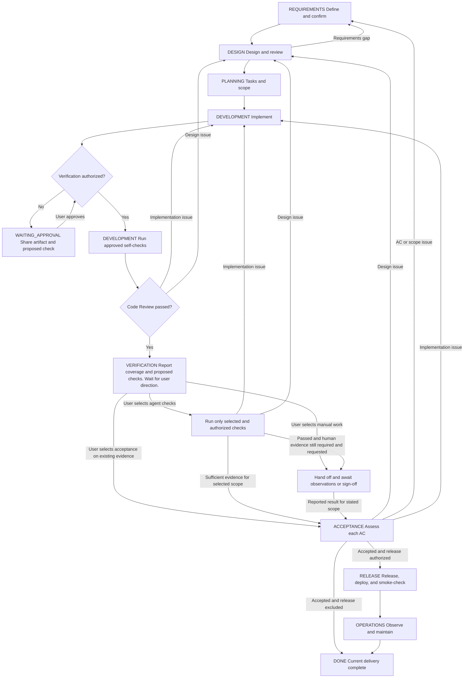

# Workflow and gates

The stage describes delivery. Record ACTIVE, WAITING_APPROVAL, BLOCKED, PAUSED, RECOVERING, or DONE separately. For example, DEVELOPMENT / RECOVERING means reconciling the baseline during development. Map existing equivalent labels where useful.

Task self-checks, code review, related integration, and AC acceptance depend on earlier results. Start eligible checks while unrelated tasks continue. Require authorization for each check, including exploratory checks, and retain all required gates.

## Stage exits

| Stage | Records and results | Exit gate |
|---|---|---|
| REQUIREMENTS | Goal, scope, constraints, business rules, AC, and review | User confirmation or a standing grant covers goal and scope. AC are observable and critical ambiguities resolved. |
| DESIGN | Implementation boundaries, interface or data changes, exception and verification strategies, and review | Map AC to implementation and checks. Keep key decisions in scope and resolve gaps that would block implementation. |
| PLANNING | Stable task IDs, goals, dependencies, scope, checks, and completion criteria | Tasks are actionable and verifiable. The execution scope is clear and all necessary prerequisites are in place. |
| DEVELOPMENT | Code or necessary executable files, progress, and self-checks | Apply [business log prefixes](../SKILL.md#business-log-prefixes). Pass applicable build, static, or scenario checks. Record unfinished and unrun work. |
| VERIFICATION | Code Review, the user-selected next step, and applicable check results | Resolve blocking issues. Evidence covers the current implementation and relevant dependencies. |
| ACCEPTANCE | AC mapping, actual results, and the agreed acceptance decision | Every in-scope AC meets the agreed acceptance mechanism, including any designated sign-off. Address unmet criteria or reconfirm an adjusted scope. |
| RELEASE | Release scope, environments, build, execution and recovery plan | Acceptance is valid, release and external actions are authorized, and post-release smoke checks pass. |
| OPERATIONS | Agreed observation, runtime notes, and issue triage | Meet observation and handoff conditions. Assign unresolved items and base stability claims on evidence. |

Finish after acceptance when release is outside the delivery. Create database artifacts, diagrams, and interface contracts only where needed.

## Verification gate

Apply this gate to documents, code, SQL, diagrams, and pages. Treat verification strategy, exit criteria, and release approval as records of what is needed. Obtain a separate or explicit grant for execution, including smoke checks and ongoing observation. Adoption and recovery may reuse existing evidence.

1. **Propose the minimum.** When an AC or concrete issue requires a check without authorization, name the object and version, related AC or issue, method and scope, run or time limit, temporary artifacts, and stop condition. Ask before execution. For an optional check, explain what would remain unverified if skipped. Propose in conversation, with no separate plan file by default.
2. **Use a valid grant.** An explicit request for the check or approval of its plan covers that scope. Reuse still-valid grants. Treat requirement confirmation, code or page creation, silence, artifact claims, and agent plans as insufficient for verification.
3. **Limit rounds.** Default to one run per authorized check and stop when it passes. After a failure, repeat only when the existing grant covers the fix and limited retest. Otherwise report the result and seek authorization. Keep regression scope focused after a change.
4. **Stop on capability limits.** Report the limitation if tooling, the environment, or interpretation fails. Use substitutes, new tools, delegation, or extra screenshots only if approved.
5. **Report the real state.** Use `未执行（待授权）` or `未执行（用户选择不执行）` when applicable. Keep tasks and stages that require evidence out of DONE. Continue authorized work outside the affected gate. Record any changed acceptance requirements.
6. **Record in place.** Keep authorization, run count, stop conditions, short results, error summaries, and evidence locations in the existing task or design. The state holds only boundaries and pointers. Keep approved temporary files in the project-root `tmp/` and clean up your own unneeded files before delivery.

## After Code Review

When Code Review passes, assess the reviewed scope against its AC and current-version evidence. Summarize the following in conversation, then **stop and wait for the user's next instruction**. This applies even if earlier grants cover checks or all evidence is already available. On resumption, use the recorded selection and still-valid grants without repeating the handoff for the same review.

| What the user needs to know | What to report |
|---|---|
| Already covered | Name the AC or scenario, the evidence and version, and what it establishes under the agreed acceptance mechanism. |
| Agent can verify | Propose the smallest check whose outcome the agent can directly observe, with scope, run limit and stop condition. Include integration only where applicable. |
| Human action or sign-off | Identify the operator or decision-maker, the scenario, expected observation and result to report. If only sign-off remains, present the evidence for that decision. |

One AC may need both agent and human evidence. Show the dependency when one side needs the other's output. Keep unknowns explicit. After the user replies, proceed only with the selected scope under the verification gate. If all evidence is sufficient, the user may choose to proceed to acceptance without another run. If a required check is deferred or declined, keep the affected AC pending unless the user explicitly changes the criterion.

Use the existing TASK or AC entry for results. Record the version, covered scenarios, actual outcome and evidence or named person's response. Permission to start is an instruction to act. Only an observed outcome or the designated person's decision can satisfy the corresponding condition. For example, if server checks pass for four regions and the user confirms client behavior in two, record server 4/4, client 2/4, and the two outstanding regions. Keep the affected delivery open until all required results are in. Use existing statuses and distinguish “awaiting instruction” from “awaiting user result” in the next action.

## Confirmation and review

A clear design and implementation grant may cover design drafting and routine task planning. Document what it covers and reuse it for the same scope. Apply the verification gate to independent reviews. Advice or a read-only review stays within its scope. A request for review covers that review. Obtain separate authorization for tests or builds.

Record the checked object and revision or code scope, method, reviewer, result, remaining conditions, and evidence in place. Identify agent self-checks as such. Apply team requirements for independent review and report who actually reviewed.

Accept evidence for the covered scope and version. When requirements, design, interfaces, or implementation change, identify the impact and mark affected gates for recheck. Update evidence under valid authorization. Use [in-place change rules](artifacts.md#living-documents-and-volume-rollover) to handle proposed changes. Routine repair need not reopen unrelated requirements. A changed business goal requires requirements work.

Record independently tracked defects under [defect tracking](bug-management.md), link the repair task, and return to the affected stage. Apply separate criteria for self-checks, defect acceptance, and release. Keep project gates and defect closure separate from individual task completion. Registration and analysis stay within the original scope.

For a gap such as deduplication across instances, first determine whether the business boundary is agreed. Return to requirements for an unresolved business rule, or to design for a missing implementation strategy. Record technical guesses as proposals.

Mark only the scope that is actually blocked. Record the missing condition, who can resolve it, and the next action. Use WAITING_APPROVAL for a required decision and RECOVERING while reconciliation is still possible. Set PAUSED from a user decision or verified project facts.

Use TODO, READY, IN_PROGRESS, VERIFYING, REVIEWING, BLOCKED, and DONE or existing equivalents for tasks. DONE requires the task's agreed conditions. Track release separately. Keep review, deferral, cancellation, and archival distinct from completion, with a visible disposition for unfinished work.

The [detailed diagram](../assets/development-flow.drawio) illustrates this workflow. If the diagram and text differ, use this document for scope, authorization, and stage gates. Apply the verification gate to its check nodes. Follow [diagram guidance](visual-communication.md) when editing it. Keep progress, waiting conditions, and rework routes visible. Layer dense diagrams in place while preserving the gates.
